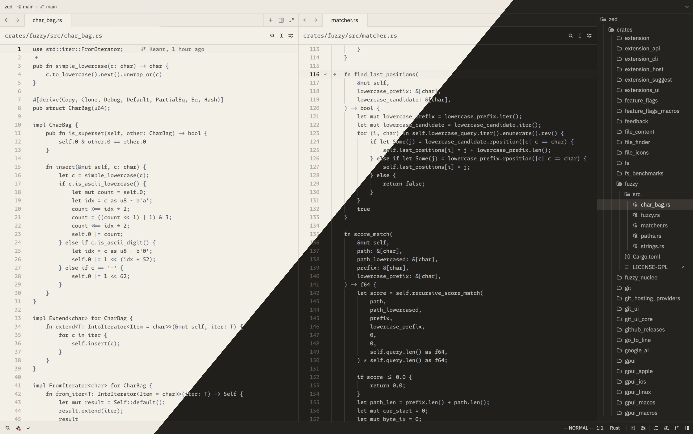

# Unwind

A calm, toned-down theme for the joy of coding.

Unwind keeps syntax restrained: soft gray text, warm gray types and literals,
muted blue punctuation, and medium-weight keywords. Warm ivory and charcoal
surfaces give the editor a soft, paper-like feel.



## Install locally

Clone this repository and copy the theme file:

```sh
git clone https://github.com/agu-z/unwind.git
mkdir -p ~/.config/zed/themes
cp unwind/themes/unwind.json ~/.config/zed/themes/
```

In Zed, open the theme selector with `Cmd+K Cmd+T` on macOS
(`Ctrl+K Ctrl+T` on Linux/Windows) and select an Unwind variant.
If it does not appear, restart Zed.

To configure both variants in your Zed settings:

```json
{
  "theme": {
    "mode": "system",
    "light": "Unwind Light",
    "dark": "Unwind Dark"
  }
}
```

## License

Derived from Zed's One theme. Distributed under the MIT license.
